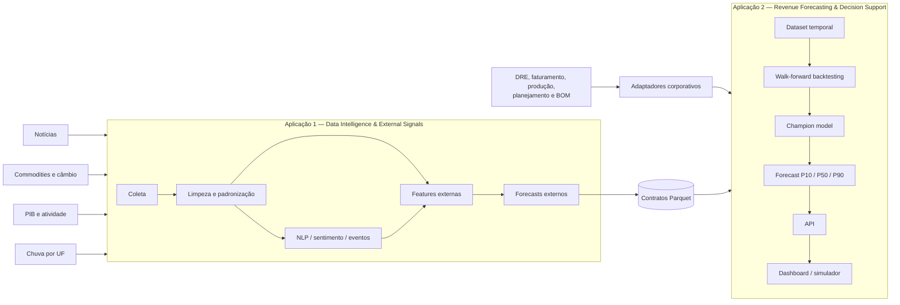
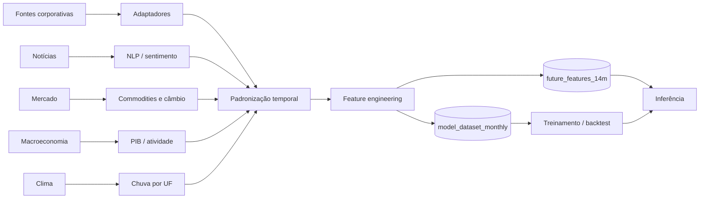
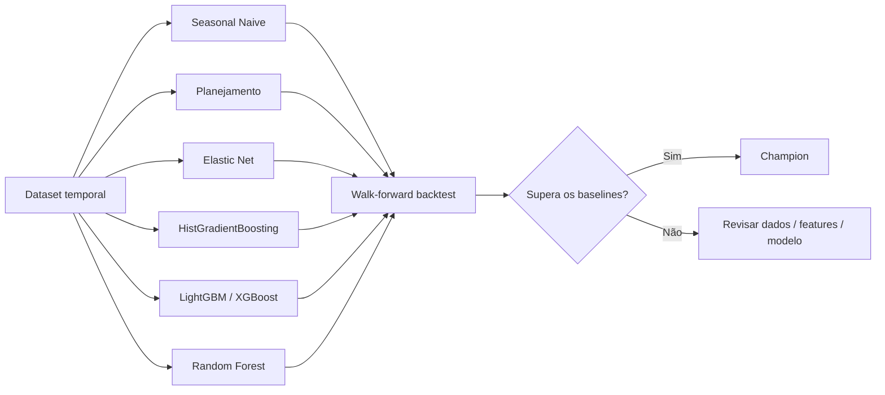
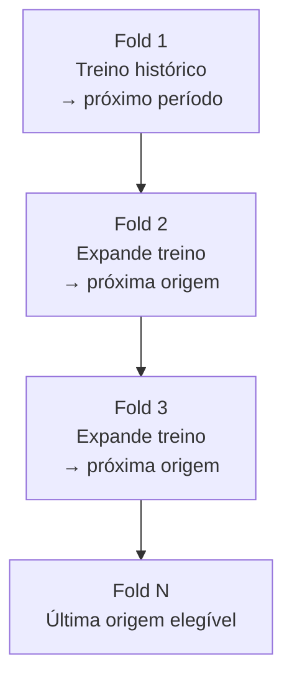
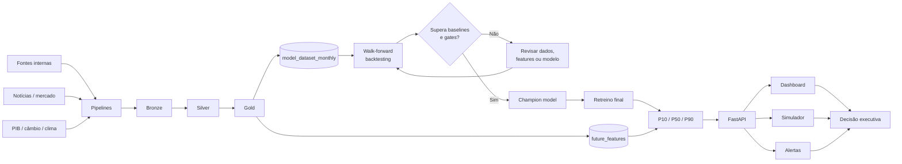

# INDÚSTRIA DE TRANSFORMADORES: PREVISÃO DE FATURAMENTO BASEADA EM CENÁRIOS

Projeto de Data Science e Machine Learning para previsão mensal de faturamento de uma indústria de transformadores, combinando dados internos de operação e finanças com sinais externos de commodities, notícias, macroeconomia, clima e câmbio.

> **Objetivo do produto:** disponibilizar previsões mensais de faturamento/receita bruta em diferentes cenários, mantendo rastreabilidade dos dados, validação temporal, controle de versões das previsões externas e uma interface web para consumo executivo.

---

## Sumário

1. [Problema e arquitetura](#1-problema-e-arquitetura)
2. [Construção do dataset e pipeline de dados](#2-construção-do-dataset-e-pipeline-de-dados)
3. [Análise exploratória dos dados](#3-análise-exploratória-dos-dados)
4. [Abordagem de modelagem e métricas](#4-abordagem-de-modelagem-e-métricas)
5. [Execução local](#5-execução-local)
6. [Execução com Docker](#6-execução-com-docker)
7. [Uso da API](#7-uso-da-api)
8. [Limitações conhecidas](#8-limitações-conhecidas)
9. [Próximos passos](#9-próximos-passos)
10. [Fluxo end-to-end](#10-fluxo-end-to-end)

---

# 1. Problema e arquitetura

## 1.1 O problema

A premissa base diz respeito à complexidade da indústria e de seu mercado. O processo produtivo é majoritariamente manual; commodities e outros insumos refletem diretamente as flutuações do mercado internacional e, muitas vezes, são importados diretamente por negociações em moeda estrangeira. Poucas linhas de negócio originam milhares de SKUs. O público-alvo se divide em grupos distintos: clientes particulares têm necessidades, requisitos e modelos de negócio distintos de concessionárias, a exemplo da exigência de peças e componentes a pronta entrega, onerando a gestão do armazém.

Isso faz com que a capacidade de planejar e antever mudanças seja imperativa à gestão eficiente e ao crescimento sustentável do negócio. Este projeto é um primeiro passo nessa direção. Seu objetivo é criar um modelo de dados capaz de realizar a previsão do faturamento mensal da empresa considerando um horizonte temporal de **12 meses**, acessível aos usuários via dashboard web que permite visualizar as previsões em três cenários distintos:

- **Base ou planejado regular**;
- **Otimista**;
- **Pessimista**.

> **Nota técnica:** embora o produto executivo tenha horizonte principal de 12 meses, a arquitetura de dados suporta previsões externas superiores a esse período, permitindo margem operacional para atualização e construção dos cenários futuros.

## 1.2 Arquitetura

O projeto consiste no desenvolvimento e treinamento de um modelo de Machine Learning para prever o faturamento mensal futuro, sendo composto por duas aplicações:

### Aplicação 1: Data Intelligence & External Signals

Responsável por coleta, limpeza, NLP, sentimento, indicadores macroeconômicos, clima e previsões de commodities.

### Aplicação 2: Revenue Forecasting & Decision Support

Responsável por integrar dados externos e internos, construir o dataset temporal, treinar modelos, gerar previsões de faturamento e disponibilizar uma interface executiva.

### Arquitetura de alto nível



---

# 2. Construção do dataset e pipeline de dados

## 2.1 O dataset é um produto do projeto

Este projeto **não parte de um dataset pronto**. O conjunto de treinamento é construído especificamente para o problema de negócio por meio de pipelines que integram fontes internas e externas com diferentes estruturas, granularidades e calendários.

O processo produz dois artefatos centrais:

```text
data/processed/
├── model_dataset_monthly.parquet   # treinamento e backtesting
└── future_features_14m.parquet     # variáveis conhecidas/previstas para inferência
```

O `model_dataset_monthly.parquet` possui granularidade **mensal**, isto é, uma linha representa uma competência.

```text
date = 2026-09-01
```

Uma linha pode combinar, entre outras variáveis:

```text
revenue
kva_produced
kva_billed
volume_units
headcount_total
dre_category_salario
dre_category_materia_prima
copper_price
aluminum_price
gdp_change_mom
rainfall_weighted
planned_kva
planned_units
```

## 2.2 Pipeline de construção



## 2.3 Fontes internas

| Domínio | Exemplos | Frequência típica |
|---|---|---|
| Faturamento | receita, canal e família de produto | mensal/anual |
| Produção | KVA produzido, KVA faturado, peças | mensal |
| Pessoas | headcount direto, indireto e administrativo | mensal |
| DRE | salários, matéria-prima, logística, despesas | mensal |
| Planejamento | unidades, KVA, ticket, capacidade | mensal |
| Custos | aço, cobre, alumínio e óleo isolante | mensal |
| Produto | mix e exposição por matéria-prima | BOM/mensal |

Planilhas gerenciais hierárquicas são convertidas por adaptadores específicos para impedir dupla contagem de totais e componentes.

Exemplo:

```text
Planilha

SALÁRIOS E ENCARGOS
└── ALTA TENSÃO               ← total utilizado
    ├── Salários e ordenados
    ├── Hora extra
    ├── Férias
    ├── INSS
    └── FGTS

                 ↓ adapter

Dataset

date        category_summary  category_dre         sector       value
2026-01-01  salario           SALARIOS E ENCARGOS  ALTA TENSÃO  ...
2026-02-01  salario           SALARIOS E ENCARGOS  ALTA TENSÃO  ...
```

## 2.4 Fontes externas

### Commodities e câmbio

O pipeline acompanha principalmente:

- cobre;
- alumínio;
- aço carbono;
- aço elétrico/aço silício;
- óleo isolante;
- USD/BRL.

Para cada commodity podem ser produzidas features como:

```text
price
return
volatility
sentiment_score
news_count
expected_price_impact
forecast_p10
forecast_p50
forecast_p90
```

### Macroeconomia

O conjunto macroeconômico pode incluir:

```text
PIB / proxy mensal de atividade
gdp_change_mom
gdp_change_yoy
produção industrial
USD/BRL
```

### Clima

A chuva possui inicialmente granularidade `mês × UF`. Para limitar a dimensionalidade, o projeto pode criar índices ponderados pela exposição comercial regional:

```python
rainfall_weighted = sum(
    rainfall_by_state * commercial_exposure_by_state
)
```

## 2.5 Camadas

```text
RAW
 ↓
BRONZE       dado bruto/imutável
 ↓
SILVER       limpo, tipado e padronizado
 ↓
GOLD         contrato pronto para consumo
 ↓
FEATURES     variáveis de ML
 ↓
MODEL DATASET
```

Exemplos de contratos Gold:

```text
sentiment_monthly.parquet
commodity_forecast_monthly.parquet
gdp_forecast_monthly.parquet
rainfall_forecast_monthly_by_state.parquet
operations_monthly.parquet
dre_category_sector_monthly.parquet
```

## 2.6 Point-in-time correctness e prevenção de leakage

Qualquer feature utilizada em um backtest deve representar somente informação disponível na origem da previsão.

Previsões externas são versionadas com campos como:

```text
forecast_origin
forecast_month
vintage_date
horizon_months
model_version
```

Exemplo:

```text
forecast_origin = 2026-11-01
vintage_date    = 2026-11-01
forecast_month  = 2027-05-01
horizon_months  = 6
commodity       = cobre
price_p50       = 9200
```

A regra básica é:

```python
eligible = forecasts[
    forecasts["vintage_date"] <= forecast_origin
]
```

Uma previsão revisada posteriormente nunca pode ser introduzida retroativamente em um backtest.

---

# 3. Análise exploratória dos dados

## 3.1 Objetivos

A EDA busca responder principalmente:

1. Como o faturamento evolui no tempo?
2. Existe sazonalidade relevante?
3. Quanto produção e faturamento estão defasados?
4. Quais sinais externos antecedem mudanças de faturamento?
5. Há mudanças de regime ou quebras estruturais?
6. Qual é a extensão dos dados ausentes e zeros legítimos?

## 3.2 Target e sazonalidade

```python
import pandas as pd
import matplotlib.pyplot as plt

monthly = pd.read_parquet(
    "data/processed/model_dataset_monthly.parquet"
)

monthly.plot(
    x="date",
    y="revenue",
    title="Faturamento mensal",
)
plt.show()
```

Para avaliar sazonalidade:

```python
monthly["month"] = monthly["date"].dt.month

seasonality = (
    monthly.groupby("month")["revenue"]
    .agg(["mean", "median", "std"])
)
```

## 3.3 Produção versus faturamento

A relação econômica esperada não é necessariamente contemporânea:

```text
KVA produzido
      ↓
estoque / testes / entrega
      ↓
KVA faturado
      ↓
faturamento
```

Por isso, investigam-se correlações defasadas:

```python
for lag in range(0, 7):
    correlation = (
        monthly["kva_produced"]
        .shift(lag)
        .corr(monthly["revenue"])
    )

    print(lag, correlation)
```

## 3.4 Commodities e sentimento

Para cada commodity são avaliados:

- preço e retorno;
- volatilidade;
- defasagens;
- sentimento;
- intensidade de cobertura noticiosa;
- impacto econômico esperado.

O sentimento textual é separado do impacto econômico do evento.

```text
Notícia:
"Grande mina de cobre suspende produção após greve"

Sentimento textual: NEGATIVO
Impacto esperado sobre o preço: POSITIVO
```

Isso evita interpretar automaticamente notícias negativas como pressão baixista sobre preços.

## 3.5 Missing values

O pipeline distingue explicitamente:

```text
0    = valor observado igual a zero
NaN  = informação ausente ou matematicamente indefinida
```

Por exemplo:

```python
avg_ticket = revenue / kva_total
```

Se `kva_total == 0`, `avg_ticket` deve permanecer `NaN`, e não zero.

O relatório de qualidade pode registrar:

```text
column
row_count
non_null_count
null_count
null_percent
zero_count
minimum
maximum
```

## 3.6 Notebooks e artefatos

```text
notebooks/
├── 01_data_quality.ipynb
├── 02_target_eda.ipynb
├── 03_operations_eda.ipynb
├── 04_commodities_eda.ipynb
└── 05_feature_analysis.ipynb
```

Gráficos recomendados:

```text
01_target_over_time.png
02_monthly_seasonality.png
03_revenue_vs_kva.png
04_lag_correlations.png
05_commodity_correlations.png
06_missingness.png
07_sentiment_vs_price.png
08_revenue_by_product_mix.png
```

---

# 4. Abordagem de modelagem e métricas

## 4.1 Formulação

O problema pode ser representado por:

```text
y_hat(t+h) = f(X_history(t), X_known_future(t+h))
```

onde:

- `y` = faturamento;
- `t` = origem da previsão;
- `h` = horizonte;
- `X_history` = informações disponíveis até a origem;
- `X_known_future` = planejamento e previsões externas válidas para o horizonte.

O produto principal trabalha com horizonte de **12 meses**, enquanto a infraestrutura pode manter um horizonte técnico ligeiramente superior para garantir continuidade das features futuras.

## 4.2 Features históricas

```text
revenue_lag_1m
revenue_lag_3m
revenue_lag_6m
revenue_lag_12m

kva_billed_lag_1m
kva_produced_lag_1m
volume_units_lag_1m

revenue_ma_3m
revenue_ma_6m
revenue_ma_12m
```

Features rolling são sempre calculadas após `shift`, evitando utilizar o próprio mês previsto.

```python
monthly["revenue_ma_3m"] = (
    monthly["revenue"]
    .shift(1)
    .rolling(3)
    .mean()
)
```

## 4.3 Features futuras

```text
planned_units
planned_kva
working_days
capacity_multiplier

copper_price_p50
aluminum_price_p50
carbon_steel_price_p50
electrical_steel_price_p50
insulating_oil_price_p50

usd_brl_forecast
gdp_change_mom
gdp_change_yoy
rainfall_weighted
```

`planned_revenue` é preferencialmente tratado como **benchmark**. Caso seja usado em modelagem, uma alternativa mais robusta é prever o desvio do planejamento:

```python
plan_ratio = actual_revenue / planned_revenue
```

## 4.4 Modelos candidatos



Deep learning, LSTM e Temporal Fusion Transformer não são priorizados inicialmente devido ao tamanho relativamente pequeno do histórico mensal.

## 4.5 Backtesting temporal

Não é utilizado split aleatório:

```python
# NÃO utilizar para este problema:
train_test_split(X, y, shuffle=True)
```

O projeto utiliza **walk-forward validation** com janela crescente.



Configuração inicial:

```yaml
backtest:
  window: expanding
  min_train_months: 36
  step_months: 1
  horizons: [1, 3, 6, 12]
```

Cada fold reconstrói o contexto que existia na data da previsão.

## 4.6 Métricas

### MAE

Erro médio absoluto em unidades monetárias:

```python
MAE = mean(abs(actual - predicted))
```

### RMSE

Penaliza erros extremos com maior intensidade.

### sMAPE

Útil para comparação percentual entre competências.

### MASE

Compara o modelo contra um baseline ingênuo/sazonal:

```text
MASE < 1  → supera o baseline
MASE = 1  → desempenho equivalente
MASE > 1  → pior que o baseline
```

### WAPE

Métrica de interpretação executiva:

```python
wape = (
    abs(actual - predicted).sum()
    / abs(actual).sum()
) * 100
```

Também são avaliados:

- erro anual acumulado;
- bias;
- acerto direcional;
- erro por horizonte;
- erro por regime de preço/atividade.

## 4.7 Cenários e intervalos

A saída não é restrita a uma estimativa pontual:

```text
P90  ───────────────────────────
         ╱                 ╲
P50  ─────── forecast base ─────
         ╲                 ╱
P10  ───────────────────────────

      Jan Fev Mar ... Nov Dez
```

No uso executivo, esses intervalos sustentam os cenários pessimista, base e otimista. A interpretação econômica deve considerar que o impacto de uma commodity sobre faturamento pode diferir do impacto sobre custo ou margem.

## 4.8 Gate de promoção

Um modelo só pode ser promovido quando:

```text
✓ supera baselines relevantes
✓ apresenta MASE < 1
✓ mantém ganho em diferentes folds
✓ não apresenta comportamento catastrófico em período específico
✓ possui intervalos adequadamente calibrados
✓ utiliza apenas features point-in-time válidas
✓ apresenta comportamento economicamente plausível
```

Artefatos de avaliação:

```text
artifacts/backtests/
├── predictions_by_origin.parquet
├── metrics_by_horizon.parquet
├── metrics_by_fold.parquet
├── baseline_comparison.parquet
├── interval_calibration.parquet
└── backtest_metadata.json
```

---

# 5. Execução local

## 5.1 Pré-requisitos

```text
Python >= 3.12
uv
Git
```

Clone o repositório:

```bash
git clone <repository-url>
cd revenue-forecast
```

Sincronize o ambiente:

```bash
uv sync --all-groups
```

Crie o `.env`:

```bash
cp .env.example .env
```

Exemplo:

```dotenv
APP_ENV=development
LOG_LEVEL=INFO
RANDOM_SEED=42

INPUT_DIR=data/input
PROCESSED_DIR=data/processed
ARTIFACT_DIR=artifacts
OUTPUT_DIR=outputs

FORECAST_HORIZON=12

DATABASE_URL=
AZURE_STORAGE_ACCOUNT=
AZURE_STORAGE_CONTAINER=
AZURE_STORAGE_SAS_TOKEN=
```

> **Segurança:** `.env` deve permanecer no `.gitignore`. Em GitHub Codespaces/CI/CD, utilize Secrets do GitHub ou um cofre dedicado de credenciais.

## 5.2 Validar dados

```bash
uv run revenue-forecast validate
```

## 5.3 Construir o dataset

```bash
uv run python scripts/build_model_dataset_monthly.py \
  --input-dir data/input \
  --output-dir data/processed \
  --quality-dir data/quality
```

Saídas:

```text
data/processed/model_dataset_monthly.parquet
data/processed/model_dataset_monthly.csv
data/quality/model_dataset_monthly_quality.csv
```

## 5.4 Executar EDA

```bash
uv run jupyter lab
```

## 5.5 Treinar

```bash
uv run revenue-forecast train
```

## 5.6 Backtest

```bash
uv run revenue-forecast backtest \
  --window expanding \
  --min-train-months 36 \
  --horizons 1,3,6,12
```

## 5.7 Forecast

```bash
uv run revenue-forecast forecast --horizon 12
```

## 5.8 Testes e qualidade de código

```bash
uv run pytest -q
uv run ruff check .
```

---

# 6. Execução com Docker

## 6.1 Dockerfile

```dockerfile
FROM python:3.12-slim

WORKDIR /app

COPY --from=ghcr.io/astral-sh/uv:latest \
    /uv /uvx /bin/

COPY pyproject.toml uv.lock ./

RUN uv sync \
    --frozen \
    --no-dev \
    --no-install-project

COPY . .

RUN uv sync \
    --frozen \
    --no-dev

ENV PATH="/app/.venv/bin:$PATH"

EXPOSE 8000

CMD [
    "uvicorn",
    "revenue_forecast.api.main:app",
    "--host",
    "0.0.0.0",
    "--port",
    "8000"
]
```

## 6.2 Build

```bash
docker build -t revenue-forecast:latest .
```

## 6.3 Treinamento

```bash
docker run --rm \
  --env-file .env \
  -v "${PWD}/data:/app/data" \
  -v "${PWD}/artifacts:/app/artifacts" \
  revenue-forecast:latest \
  revenue-forecast train
```

## 6.4 Forecast

```bash
docker run --rm \
  --env-file .env \
  -v "${PWD}/data:/app/data" \
  -v "${PWD}/artifacts:/app/artifacts" \
  -v "${PWD}/outputs:/app/outputs" \
  revenue-forecast:latest \
  revenue-forecast forecast --horizon 12
```

## 6.5 API

```bash
docker run --rm \
  --env-file .env \
  -p 8000:8000 \
  revenue-forecast:latest
```

---

# 7. Uso da API

A camada de serving pode ser implementada com FastAPI.

## 7.1 Health check

```http
GET /health
```

Resposta:

```json
{
  "status": "ok",
  "model_loaded": true,
  "model_version": "1.0.0"
}
```

## 7.2 Forecast

```http
POST /v1/forecast
```

Exemplo:

```bash
curl -X POST \
  http://localhost:8000/v1/forecast \
  -H "Content-Type: application/json" \
  -d '{
    "forecast_origin": "2026-11-01",
    "horizon_months": 12,
    "scenario": "base"
  }'
```

Resposta ilustrativa:

```json
{
  "forecast_origin": "2026-11-01",
  "scenario": "base",
  "model_version": "1.0.0",
  "predictions": [
    {
      "date": "2026-12-01",
      "p10": 72000000,
      "p50": 79500000,
      "p90": 87500000
    },
    {
      "date": "2027-01-01",
      "p10": 74000000,
      "p50": 81800000,
      "p90": 90200000
    }
  ]
}
```

> Os números acima são exclusivamente exemplos de estrutura do payload.

## 7.3 Simulação de cenário

```http
POST /v1/scenarios
```

```json
{
  "forecast_origin": "2026-11-01",
  "scenario": "custom",
  "assumptions": {
    "copper_price_multiplier": 1.10,
    "aluminum_price_multiplier": 1.05,
    "planned_kva_multiplier": 0.95,
    "usd_brl_multiplier": 1.08,
    "gdp_adjustment": -0.01
  }
}
```

Isso suporta perguntas como:

> Qual o faturamento esperado se o cobre subir 10%, o USD/BRL 8% e apenas 95% do KVA planejado for realizado?

## 7.4 Drivers

```http
GET /v1/forecast/{forecast_id}/drivers
```

Exemplo ilustrativo:

```json
{
  "forecast_id": "fcst_20261101_base",
  "drivers": [
    {"feature": "planned_kva", "impact": 0.31},
    {"feature": "revenue_lag_12m", "impact": 0.22},
    {"feature": "copper_price_p50", "impact": -0.11}
  ]
}
```

---

# 8. Limitações conhecidas

## 8.1 Histórico mensal relativamente curto

O número de observações é pequeno diante da quantidade potencial de features. Isso aumenta o risco de overfitting e reduz a atratividade inicial de modelos de deep learning.

Mitigação:

- regularização;
- feature selection;
- baselines fortes;
- walk-forward validation;
- modelos tabulares;
- redução de dimensionalidade orientada ao negócio.

## 8.2 Vintages históricos das previsões externas

Backtesting rigoroso exige conhecer qual forecast de commodity, PIB, câmbio ou chuva estava efetivamente disponível em cada origem histórica.

Sem vintages históricos, existe risco de testar o modelo com informações revisadas ou realizadas posteriormente.

## 8.3 Planejamento é revisável

Versões de planejamento não devem ser sobrescritas.

Guardar:

```text
plan_version
vintage_date
valid_from
generated_at
```

## 8.4 PIB mensal

O indicador utilizado precisa explicitar se representa PIB, proxy de atividade ou forecast derivado. Revisões estatísticas também precisam respeitar point-in-time correctness.

## 8.5 Chuvas por UF

Usar diretamente dezenas de séries estaduais pode elevar excessivamente a dimensionalidade. O MVP prioriza índices ponderados por exposição comercial, carteira ou KVA entregue.

## 8.6 Relação entre commodity e faturamento

Alta de commodity não implica necessariamente redução do faturamento. Os contratos podem repassar preços e elevar receita nominal mesmo quando margens são pressionadas.

Portanto, o sistema deve distinguir:

```text
efeito sobre faturamento
efeito sobre custo
efeito sobre margem
```

## 8.7 Cenários não são garantias

P10, P50 e P90 representam distribuições estimadas a partir dos dados e hipóteses disponíveis. Os cenários devem apoiar decisão, e não ser interpretados como garantias financeiras.

---

# 9. Próximos passos

## Dados

- [ ] Consolidar `revenue_monthly.parquet` como target oficial.
- [ ] Integrar carteira e backlog.
- [ ] Incorporar USD/BRL histórico e futuro.
- [ ] Consolidar BOM e exposição por matéria-prima.
- [ ] Criar exposição geográfica por UF.
- [ ] Formalizar os contratos Gold entre as duas aplicações.

## Previsões externas

- [ ] Persistir `vintage_date` em todas as previsões.
- [ ] Gerar vintages históricos por walk-forward.
- [ ] Produzir cenários P10/P50/P90 de commodities.
- [ ] Incorporar atividade econômica/PIB.
- [ ] Criar índice pluviométrico ponderado.
- [ ] Incorporar forecast de USD/BRL.

## Modelagem

- [ ] Seasonal Naive.
- [ ] Baseline de planejamento.
- [ ] Elastic Net.
- [ ] HistGradientBoosting.
- [ ] LightGBM/XGBoost.
- [ ] Random Forest challenger.
- [ ] Modelo de correção do planejamento.
- [ ] Seleção automática do champion.
- [ ] Calibração dos intervalos P10/P50/P90.

## MLOps

- [ ] Dataset versioning.
- [ ] Model Registry.
- [ ] Monitoramento de data drift.
- [ ] Monitoramento de concept drift.
- [ ] Retreinamento controlado.
- [ ] CI/CD.
- [ ] Aprovação antes de promoção.
- [ ] Rollback de modelo.

## Produto

- [ ] FastAPI.
- [ ] Dashboard executivo.
- [ ] Simulador de cenários.
- [ ] Comparativo Forecast × Plano × Realizado.
- [ ] Drivers e explicabilidade.
- [ ] Exportação Excel/CSV.
- [ ] Alertas de desvios relevantes.
- [ ] Autenticação corporativa.

---

# 10. Fluxo end-to-end



---

## Princípios técnicos do projeto

1. **Nenhum dado futuro pode vazar para o treinamento.**
2. **Toda previsão externa deve possuir vintage e horizonte identificáveis.**
3. **Dados realizados, planejados e previstos são entidades diferentes.**
4. **O dataset é um produto versionado do pipeline, não um arquivo estático.**
5. **Modelos só são promovidos quando superam baselines fora da amostra.**
6. **Previsões precisam ser explicáveis e rastreáveis até suas entradas.**
7. **Cenários apoiam decisões; não substituem julgamento executivo.**
